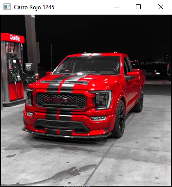
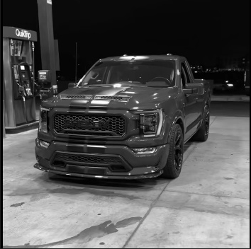
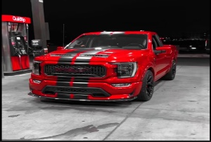
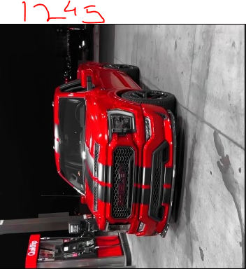
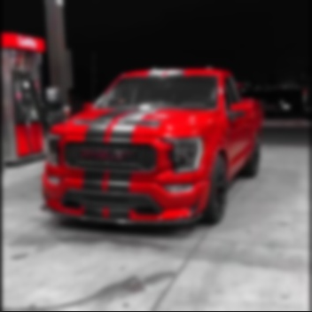
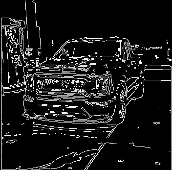
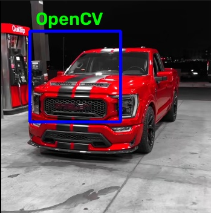
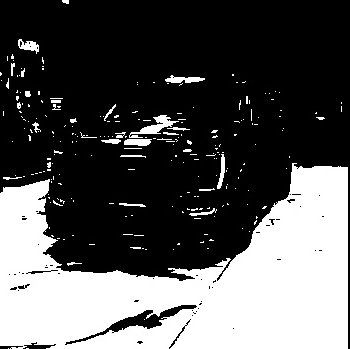
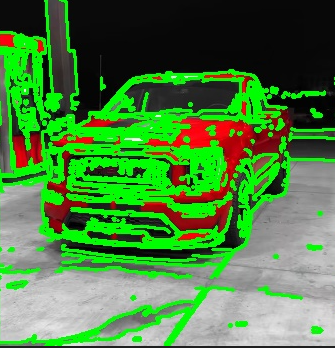

## 1. Leer y mostrar imagen

## 2. Convertir a escala de grises

## 3. Redimensionar imagen

## 4. Rotar imagen 90 grados

## 5. Aplicar desenfoque gaussiano

## 6. Detectar bordes con Cann

## 7. Dibujar rectangulo y texto

## 8. Aplicar umbralizacion

## 9. Encontrar y dibujar contornos

